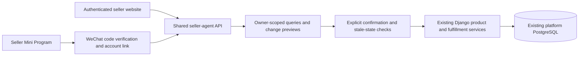

# Delivery update — 16 October 2026

> This document combines reusable API/acceptance instructions with dated delivery history. Historical test counts and phone confirmations are not current release certification. For present scope use [current status](OUTSTANDING_TASKS.md); for fresh local setup use [development setup](BEGINNER_SETUP.md).

Current integrated entry points and acceptance instructions are in
[UNIFIED_DELIVERY.md](UNIFIED_DELIVERY.md): buyer website plus seller Mini Program.
The website seller workspace below is retained as historical implementation detail.

See [TEAM_ACCEPTANCE.md](TEAM_ACCEPTANCE.md) for the earlier seller-only acceptance record.
Seller website and real-phone acceptance are complete for this team test build.
The owner confirmed all four phone actions; stored stock, price, unpublished
listing and fulfillment results were independently checked. This is not a
production or public Mini Program release.
The phone HTTPS host now serves the authenticated product editor, including
photo upload, options and publication. Dispatch eligibility is shared by both
clients. The latest native page-handler harness also passes price and shipment
writes. The historical test counts below describe earlier runs; final counts
are recorded in the delivery verification report.

# Seller website and WeChat Mini Program progress — 16 October 2026

This implementation follows the seller direction in the canonical handover.
The user's current scope includes **phone scanning and real WeChat login**.
Local DevTools integration is verified. A separate phone project uses the actual
Mini Program AppID and an HTTPS backend; see [SELLER_PHONE.md](SELLER_PHONE.md).
An official preview QR was generated. After correcting the server credential,
a real DevTools wx.login code was successfully exchanged by the phone backend.
The user configured the request domain, scanned the original QR on a phone,
and supplied a valid phone-generated linking request. The website-authenticated
API successfully linked that WeChat identity to the existing demo seller.
The user confirmed that both product and order lists display on the phone.
Stock, price, draft creation and fulfillment confirmations also passed on the real phone; backend audit records show `confirmed_channel=wechat` for all four.

## Baseline and preserved work

- Base: `origin/main` at `83e1a9e`, including the merged human messaging and
  Samuel's per-seller fulfillment safety changes.
- Branch: `codex/seller-wechat-agent`; local checkout:
  `D:\CodexWork\DIP\dip-seller-wechat`.
- The earlier checkout, its uncommitted code and its customer-service demos
  remain at `D:\CodexWork\DIP\dip-new-repo-test`.
- No changes to existing order/payment services or ownership rules. The new
  assistant uses the existing `Product`, `ProductVariant`, `Order`, `OrderItem`
  and `SellerFulfillment` models and `update_seller_fulfillment` service.
- The launcher uses the existing platform database through `DIP_ENV_FILE`.
  It does not create another commerce database or clone sellers/catalogues.
  Django's test runner creates its normal temporary test database.

## Implemented slice

| Capability | Current result |
| --- | --- |
| Website seller assistant | Authenticated `/seller/ai/`; linked from the seller dashboard. |
| Seller Mini Program | Native files under `miniprogram/`, plus a browser preview of the same API. |
| Account linking | Mini session starts unlinked; a website-authenticated user approves a five-minute, single-use ticket with its six-character pairing code. No automatic seller role or maker creation. |
| Product/stock queries | Actual owner-scoped products and variants, including low-stock options on products whose combined stock is high. |
| Order queries | Actual owner-scoped order lines and that seller's fulfillment. Human buyer/seller messaging remains a separate feature. |
| Inventory and price writes | Exact preview, explicit confirmation, ownership recheck, locked rows, stale-data rejection and idempotent application. Variant stock is authoritative. |
| Listing onboarding | Collect name, category, description, price and quantity over multiple messages. A user without verified seller access can collect details but cannot create a product. |
| Product creation | Confirmed creation produces an **unpublished** product draft. Images, option management and publication use the existing authenticated product editor. |
| Fulfillment write | Preview and confirm a paid, eligible order's own parcel, using the existing locked service. Does not rewrite the parent order carrier or another seller's parcel. |
| AI | The public seller web demo enables DeepSeek for natural English/Chinese requests, follow-ups and seller advice. Exact quick actions remain guided. Phone/release configurations retain their own opt-in settings; mocked regression tests never spend provider quota. Model output never confirms writes. |
| Buyer AI shopping discovery | Not part of this increment. The merged buyer/seller messaging UI does not establish buyer product-discovery AI. |
| Live WeChat | **Phone QR opening, real login-code exchange, phone account linking and user-confirmed product/order display passed. Real-phone stock, price, unpublished draft creation and shipment confirmations also passed.** |

## Architecture



Seller conversations and previews are auxiliary records, not alternative orders
or inventory. Both entry points see the same conversation IDs and confirmed
changes. New API prefix: `/api/seller-agent/v1/`.

## Run locally

On the prepared computer, double-click `START-SELLER-WECHAT.cmd`. It uses the
existing sibling Python runtime and the existing platform `.env` file.
`STOP-SELLER-WECHAT.cmd` asks only this local server to stop.

- Website: `http://127.0.0.1:8780/seller/ai/`
- Browser Mini Program preview: `http://127.0.0.1:8780/seller/ai/mini-preview/`
- WeChat DevTools: import the `miniprogram` directory. This checkout uses the
  AppID already present in the user's local example project. Team members need
  access to that Mini Program, or must set an AppID they can manage.
  `authMode: 'developer'` still uses the local Django identity flow.
  DevTools 2.02.2608080 rejects the old `touristappid` placeholder via the CLI.

For another installation, follow the repository's existing Django/PostgreSQL
setup, install `requirements.txt`, create a normal `.env`, then run
`python run_seller_agent.py --env-file /path/to/platform.env`.
The local runner binds loopback and enables guarded developer login. Do not
deploy `config.seller_agent_local` or this runner as a public production service.

The native client and browser preview start without a privileged account.
Choose **Generate secure linking request**, copy/open its URL, sign into the
website with your intended account and enter the code shown in the Mini session.
Select **Refresh** in the Mini session. An existing active maker/seller is still
required for private commerce operations.

## Local acceptance walkthrough

1. Link a local Mini session to the existing test seller through the website.
2. Ask `my products`, `low stock`, `my orders`; verify the same records on the website.
3. Ask `new listing`. Supply each requested field, or use
   `name=Test Mug; category=ceramics; description=Handmade mug; price=20; quantity=7`.
4. Review and confirm. Verify the product is unpublished and opens in the
   existing product editor. The assistant does not claim to have published it.
5. On its product card enter stock `9`, preview the change, verify the live
   quantity remains `7`, then confirm and verify `9` on both channels.
6. Prepare shipping on a paid eligible order; confirm that only this seller's
   fulfillment changes. Unpaid, stale, cancelled and cross-seller cases fail.
7. Unlink the Mini session from the website and verify the token stops working.

Guided text examples: `my products`, `low stock`, `my orders`, `new listing`,
`set stock EXACT PRODUCT NAME to 5`, `set price EXACT PRODUCT NAME to 25.50`.
Use the product card's option selector for a variant-specific update.

## API outline

- `GET status/`: configuration status and public onboarding guidance.
- `POST session/login/`: official `wx.login()` code exchange; no developer fallback.
- `POST session/developer/`: local-only unlinked identity; checks DEBUG, feature
  flag, loopback peer and Host. No user/maker is created.
- `GET me/`, `POST session/logout/`: current session and revocation.
- `POST link/start/`: an expiring linking URL and pairing code.
- `POST link/approve/`: website session/JWT only; token, code and `confirmed:true`.
- `GET links/`, `POST links/{id}/unlink/`: account-owned connections and revocation.
- `GET/POST conversations/`, `GET conversations/{id}/`.
- `POST conversations/{id}/messages/`: `request_id` UUID and `text`.
- `GET snapshot/`: authorized current products/orders.
- `POST conversations/{id}/changes/`: `request_id`, action, target, validated values.
- `POST changes/{id}/confirm/`: `confirmed:true`; returns the actual result.

Mini requests use `Authorization: SellerWechat <opaque token>`. Browser requests
use the existing website session and CSRF cookie; JWT remains supported.
Only token hashes and hashed OpenIDs are stored. Successful official login codes
are marked used. Linking tickets are one-use and expire after five minutes;
sessions expire after eight hours. Unlink revokes sessions and unused tickets.

## Live platform gate

The Mini Program is the selected WeChat channel. It calls HTTPS APIs directly;
this increment does not expose an Official Account message webhook or implement
WeCom/consumer-WeChat bots. Do not claim those channels or their signature checks.

For deployment on another account: obtain the intended Mini Program account and developer
permissions; configure AppID and AppSecret on the server, keep the secret out of
client code; set `WECHAT_SELLER_ENABLED=1`, `WECHAT_SELLER_DEV_LOGIN=0`; set the
client to `authMode: 'wechat'`, real AppID and approved HTTPS API origin. Re-enable
DevTools domain checks. Verify official login, binding, expiry/revocation, basic
and verified seller flows on a real test device. Consult current WeChat platform
documentation for account eligibility and release requirements; they have not
been independently verified here because the official documentation was not
retrievable by the browsing tool.

No WeChat Pay, notifications, public-account callback,
refund, deletion, bulk editing or autonomous publication was added.

## Validation commands

Verified locally on 16 October 2026:

- Full isolated Django regression: **455 tests passed** across accounts,
  products, orders, payments, reviews, content, recommendations, messaging,
  seller-agent, frontend and imagery.
- Final seller-agent suite after the made-to-order display adjustment:
  **22 tests passed**. Covers identity linking/revocation, cross-seller isolation,
  preview-only writes, stale/expired changes, confirmation replay, variants,
  draft onboarding, fulfillment eligibility and model failures.
- Phone-host and seller-agent suite after phone preview work: **27 tests passed**,
  including restricted public routes, authenticated account linking, secure login,
  and an invalid-AppSecret response that does not expose upstream data.
- Native Mini Program page-handler integration against real Django: passed
  shared conversations, unpublished listing creation, stock **7 → 9** only after
  confirmation, idempotent confirmation, filtered low-stock results, owner-scoped
  order queries and revoked-session rejection. `wx` was mocked; this does not
  claim DevTools compilation or live WeChat acceptance.
- Browser account linking and shared-data preview checked. JavaScript syntax,
  migration drift and Git whitespace checks passed.
- Actual WeChat DevTools 2.02.2608080 / WeChatLib 3.17.4: imported the project,
  compiled WXML and WXSS, rendered the native page, linked the local demo seller,
  and queried 11 products, 4 low-stock products and 4 orders with real `wx.request`
  calls to Django. The console error query returned no entries after the fix.
  Fixed an escaped `&amp;&amp;` expression that ordinary XML structure checking
  had missed: WXML requires `&&` inside its expressions. Also clear the consumed
  pairing request after linking and hide seller-onboarding guidance for a
  verified seller. That earlier local check did not claim real-device login. Later real-phone login and reads passed, as recorded above; no publication is claimed.

The full regression preceded the final Mini Program result-filter adjustment;
the native integration was rerun successfully after that adjustment. Test runs
used isolated temporary PostgreSQL databases; the native integration used the
existing local demo seller and left named unpublished validation products.

```text
python manage.py test seller_agent --noinput
python manage.py test accounts products orders payments reviews recommendations messaging seller_agent frontend --noinput
node miniprogram/tests/local-integration.cjs
```

The Node integration harness requires `SELLER_TEST_EMAIL` and
`SELLER_TEST_PASSWORD` for a disposable local seller. It mocks `wx` while calling
the real local Django API. It leaves one named **unpublished** validation product,
tests a confirmed stock change and revokes its test Mini session. It is not a
real WeChat runtime test.
